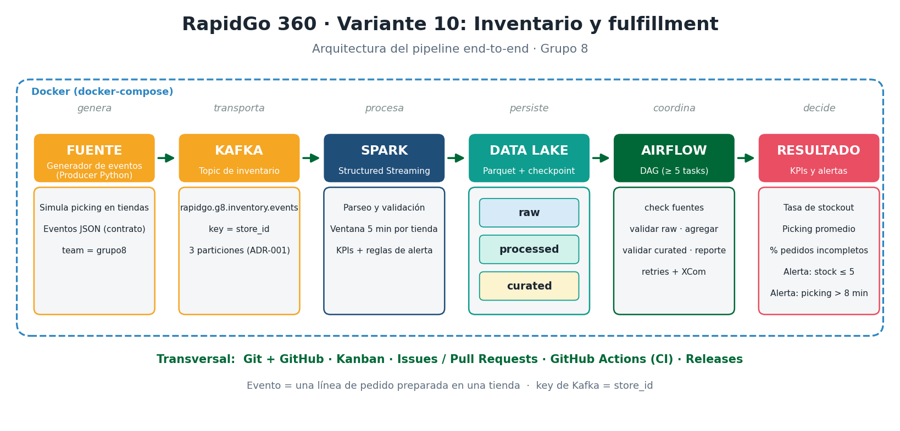

# RapidGo · Variante 10 · Inventario y fulfillment

Proyecto final de Big Data (Línea de Profundización I) · **Grupo 8** · Release final **v1.0.0**

**Video final (≤ 10 min):** [ver en Google Drive](https://drive.google.com/drive/folders/1e-yPPIMx5dIkdR79krz2FH8zi5PwIf0o?usp=sharing)

| Integrante | GitHub |
|---|---|
| Jhonatan Santiago López | [@jsantiagolopez7](https://github.com/jsantiagolopez7) |
| Andrey Espitia | [@AndreyEspitia](https://github.com/AndreyEspitia) |
| Eric Vargas | [@evarg4sc](https://github.com/evarg4sc) |

## 1. Problema de negocio y valor

Los comercios aliados de RapidGo sufren agotados (stockouts) y demoras en el picking, lo que genera pedidos incompletos y retrasos en la entrega. Este proyecto construye un pipeline de datos que:

- detecta en tiempo casi real el **stock crítico** y el **picking fuera de tiempo**,
- calcula **KPIs por tienda** en ventanas de 5 minutos y un consolidado diario,
- y solo publica KPIs diarios cuando los datos pasan **reglas de calidad**.

Con esto, un operador de tienda sabe qué productos se están agotando y qué tiendas tienen el picking lento, antes de que el problema llegue al cliente.

## 2. Arquitectura



```
Producer (Python) → Kafka (rapidgo.g8.inventory.events, 3 particiones, key store_id)
   → Spark Structured Streaming → Data Lake: raw → processed → curated (Parquet)
   → Airflow (DAG diario de calidad y KPIs) → reporte Markdown
```

Detalle en [docs/arquitectura.md](docs/arquitectura.md). Decisiones principales:

| ADR | Decisión |
|---|---|
| [ADR-001](docs/decisions/ADR-001-key-y-particiones-kafka.md) | Key `store_id` y 3 particiones: orden de los eventos por tienda. |
| [ADR-002](docs/decisions/ADR-002-ajuste-de-umbrales.md) | La alerta de stock crítico solo se dispara cuando un picking deja el stock en 5 o menos (antes alertaba en el 69 % de los eventos). |
| [ADR-003](docs/decisions/ADR-003-orquestacion-y-recuperacion.md) | El streaming corre aparte y Airflow orquesta un DAG batch diario con *fail fast*, retries e idempotencia. |

## 3. Tecnologías

| Tecnología | Versión | Rol |
|---|---|---|
| Apache Kafka (KRaft) | 3.9.0 | Bus de eventos: recibe los eventos del producer y los conserva por partición. |
| Apache Spark (Structured Streaming) | 3.5.3 | Lee Kafka, valida el contrato, deduplica, calcula KPIs por ventana y alertas, y escribe el Data Lake. |
| Parquet | - | Formato del Data Lake (raw, processed, curated). |
| Apache Airflow | 2.10.5 | Orquesta el DAG diario de calidad, KPIs diarios y reporte. |
| Python | 3.12 | Producer, reglas de calidad, pruebas. |
| Docker Compose | - | Levanta Kafka, Spark, Airflow y el producer en local. |
| pytest + GitHub Actions | - | Pruebas automáticas, CI en cada PR y quality gate del release. |

## 4. Ejecución local

### Prerequisitos
- Docker Desktop (o Docker Engine) con Docker Compose v2 y al menos 4 GB de RAM para Docker. En Windows con WSL2 el límite se ajusta en `%UserProfile%\.wslconfig` (`[wsl2]` y `memory=4GB`). Con poca RAM, levanta primero `kafka kafka-init spark-master` y Airflow al final.
- Git.
- Python 3.12 (solo para correr las pruebas fuera de Docker).
- Puertos libres: 29092 (Kafka), 8080 y 7077 (Spark), 8081 (Airflow).

### Paso 1: clonar y levantar los servicios
```bash
git clone https://github.com/jsantiagolopez7/rapidgo-variant10-grupo8.git
cd rapidgo-variant10-grupo8
docker compose config -q     # valida el archivo (sin salida = OK)
docker compose up -d
docker compose ps -a         # kafka-init debe quedar en "Exited (0)"
```

| Servicio | Qué hace | Acceso |
|---|---|---|
| `kafka` | Broker Kafka 3.9.0 en modo KRaft | `localhost:29092` (desde tu máquina), `kafka:9092` (entre contenedores) |
| `kafka-init` | Crea el topic con 3 particiones y termina | - |
| `spark-master` | Spark 3.5.3 | UI en http://localhost:8080 |
| `airflow` | Airflow 2.10.5 standalone | UI en http://localhost:8081 (`admin` / `admin`) |
| `producer` | Generador de eventos (se corre a demanda) | - |

Verificar el topic (debe mostrar `PartitionCount: 3`):
```bash
docker compose exec kafka /opt/kafka/bin/kafka-topics.sh \
  --bootstrap-server kafka:9092 --describe --topic rapidgo.g8.inventory.events
```

### Paso 2: arrancar el job de Spark (terminal 1)
```bash
docker compose exec spark-master /opt/spark/bin/spark-submit \
  --master local[2] \
  --packages org.apache.spark:spark-sql-kafka-0-10_2.12:3.5.3 \
  /opt/app/spark/streaming_job.py
```
La primera vez descarga el conector de Kafka (1 o 2 minutos). Déjalo corriendo.

### Paso 3: enviar eventos (terminal 2)
```bash
docker compose run --rm producer --max-events 0 --rate 5   # continuo, Ctrl+C para parar
```
Los KPIs por ventana de 5 minutos aparecen cuando la ventana cierra (5 min + 1 min de watermark), así que deja el producer corriendo al menos 8 minutos.

### Paso 4: revisar el Data Lake
```bash
docker compose exec spark-master /opt/spark/bin/spark-submit /opt/app/spark/revisar_datalake.py
```
Los archivos quedan en `datalake/` (ver [datalake/README.md](datalake/README.md)).

### Paso 5: ejecutar el DAG en Airflow
1. Abre http://localhost:8081 (usuario `admin`, contraseña `admin`).
2. Activa el DAG `rapidgo_g8_inventario_diario` con el interruptor de la izquierda.
3. Pulsa ▶ (*Trigger DAG*) y mira la vista *Grid*: las 5 tasks deben quedar en verde.

Desde la terminal:
```bash
docker compose exec airflow airflow dags unpause rapidgo_g8_inventario_diario
docker compose exec airflow airflow dags trigger rapidgo_g8_inventario_diario
docker compose exec airflow airflow dags list-runs -d rapidgo_g8_inventario_diario
```
El reporte queda en `airflow/reports/reporte_inventario_<fecha>.md` y los KPIs diarios en `datalake/curated/kpis_diarios/`.

### Apagar
```bash
docker compose down        # conserva datos
docker compose down -v     # borra también el volumen de Kafka
```

## 5. Topic, evento, KPIs y reglas

**Topic:** `rapidgo.g8.inventory.events` · key `store_id` · 3 particiones.

**Evento:** contrato en [samples/evento_inventario.schema.json](samples/evento_inventario.schema.json) y ejemplo en [samples/evento_inventario.json](samples/evento_inventario.json). Tipos: `ITEM_PICKED`, `ITEM_OUT_OF_STOCK`, `STOCK_REPLENISHED`.

**KPIs (Spark, por tienda y ventana de 5 min; Airflow, por tienda y día):**
- Tasa de stockout
- Tiempo promedio de picking y p95
- Porcentaje de pedidos incompletos

**Alertas:**
- Stock crítico: un `ITEM_PICKED` deja `stock_after <= 5` (ALTA si queda en 0).
- Picking fuera de tiempo: más de 8 minutos por pedido.

**Reglas de calidad del DAG** (`airflow/dags/calidad_inventario.py`):
- `check_sources`: raw y processed existen y tienen registros.
- `validate_raw`: máximo 5 % de eventos fuera del contrato.
- `validate_curated`: sin nulos ni duplicados por (fecha, tienda), tasas en [0, 1] y tiempos ≥ 0.

### DAG `rapidgo_g8_inventario_diario`
```
check_sources -> validate_raw -> aggregate_daily_kpis -> validate_curated -> generate_report
```
Todas las tasks tienen 2 retries con backoff exponencial y se pasan rutas y conteos por XCom. Si una fuente falta, `check_sources` falla y las demás quedan en `upstream_failed`: no se publican KPIs sobre datos vacíos. Se recupera corrigiendo la causa y haciendo *Clear* de la ejecución ([checkpoint Semana 3](docs/checkpoints/semana3.md)).

## 6. Pruebas y GitHub Actions

```bash
pip install -r requirements.txt
pytest -v
```
Las pruebas cubren el contrato del evento, producer, transformaciones de Spark, reglas de calidad del DAG e integridad del DAG (esta última se omite sola si Airflow no está instalado).

| Workflow | Cuándo corre | Qué valida |
|---|---|---|
| `CI RapidGo` (`.github/workflows/ci.yml`, job `validar`) | Cada PR y push a `main`; también a mano | Sintaxis, `pytest -v` (con Java para PySpark) y `docker compose config`. |
| `CI DAG Airflow` (`.github/workflows/ci-dag.yml`, job `dag`) | Cada PR y push a `main`; también a mano | Instala Airflow 2.10.5, compila `airflow/` y corre `tests/test_dag_integrity.py`: el DAG importa sin errores, tiene 5 o más tasks, todas con dependencias y retries. |
| `Release RapidGo` (`.github/workflows/release.yml`) | Solo a mano (`workflow_dispatch`) | **Quality gate:** repite las dos validaciones anteriores y solo si ambas pasan crea el tag y el GitHub Release. |

**Correr un workflow a mano:** pestaña **Actions** → elige el workflow → **Run workflow** → rama `main` → **Run workflow**.

## 7. Resultados

| Ejecución | Resultado |
|---|---|
| Streaming, 29/10/2026 (8 min) | 6.491 eventos enviados (+120 duplicados a propósito); raw con 6.284 y processed con 6.168 (la validación y la deduplicación quitaron 116). 32 filas de KPIs (8 tiendas × 4 ventanas). Picking promedio 162,8 s, p95 240 s. |
| Ajuste de alertas (ADR-002) | STOCK_CRITICO pasó de dispararse en el 69 % de los eventos (4.245 alertas) a solo cuando un picking deja el stock bajo. |
| DAG, 08/11/2026 | 5 tasks en `success`: 1.531 eventos en raw, 0 inválidos, KPIs diarios para 8 tiendas y reporte generado. |
| Fallo controlado, 08/11/2026 | `check_sources` falló en sus 3 intentos y las 4 tasks siguientes quedaron en `upstream_failed`; tras *Clear* la ejecución terminó en verde en 25 s. |
| Integración final desde cero, 11/11/2026 | 3.731 eventos (+59 duplicados); raw 3.790, processed 3.731, 24 filas de KPIs y 884 alertas. Picking promedio 163,3 s, p95 240 s, stockout 42,55 %. DAG en verde con 0 eventos fuera del contrato, KPIs para 8 tiendas y 988 de 1.442 pedidos incompletos. |

Capturas en [docs/checkpoints/](docs/checkpoints/). Checkpoints: [Semana 1](docs/checkpoints/semana1.md) · [Semana 2](docs/checkpoints/semana2.md) · [Semana 3](docs/checkpoints/semana3.md) · [Semana 4](docs/checkpoints/semana4.md).

## 8. Limitaciones y trabajo futuro

- **Un solo broker y factor de replicación 1.** Suficiente para local; en producción harían falta 3 brokers y replicación 3.
- **Airflow no vigila el streaming.** Si el job de Spark se cae, se detecta al día siguiente en `check_sources`. Mejora: un sensor o una alerta de salud del job.
- **`aggregate_daily_kpis` usa pandas** y lee todo `processed/`. Sirve para miles de eventos; con millones habría que filtrar por la partición `fecha` o pasar la task a Spark.
- **Datos simulados.** El producer genera eventos sintéticos; los umbrales (5 unidades, 8 minutos) deberían calibrarse con datos reales.
- **Airflow en modo standalone** (un contenedor, SQLite). En producción: base de datos Postgres y executor Celery o Kubernetes.

## 9. Tabla de contribuciones

| Integrante | Responsabilidades | Issues principales | PRs principales |
|---|---|---|---|
| Jhonatan Santiago López | Repositorio, Kanban y estructura (S1); producer de eventos (S2); DAG de Airflow, ADR-003 y release v0.3.0 (S3); integración end-to-end (S4) | #1, #2, #9, #14, #17, #18 | #23, #27, #29, #34 |
| Andrey Espitia | Arquitectura, contrato JSON y KPIs (S1); job de Spark, alertas y Parquet (S2); CI ampliado del DAG y pruebas de calidad (S3); quality gate y release v1.0.0 (S4) | #3, #4, #5, #10, #11, #15, #19 | #24, #30, #33 |
| Eric Vargas | docker-compose, README y ADR-001 (S1); pruebas, CI, ADR-002 y release v0.2.0 (S2); fallo controlado y checkpoint 3 (S3); README final (S4) | #6, #7, #8, #12, #13, #16, #20 | #25, #28, #31, #32, #35 |
| Todos | Revisión cruzada de PRs, `workflow_dispatch` y video final | #21, #22 | - |

Releases: [v0.1.0-foundation](../../releases/tag/v0.1.0-foundation) · [v0.2.0-streaming](../../releases/tag/v0.2.0-streaming) · [v0.3.0-orchestration](../../releases/tag/v0.3.0-orchestration) · [v1.0.0](../../releases/tag/v1.0.0)
