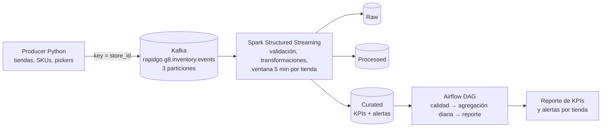

# Arquitectura - Variante 10: Inventario y fulfillment

Pendiente: exportar este diagrama como `docs/arquitectura.png` (por ejemplo desde mermaid.live o draw.io).

## KPIs

| KPI | Cálculo | Granularidad |
|---|---|---|
| Tasa de stockout | líneas con `qty_picked < qty_requested` por falta de stock / total de líneas | tienda, ventana de 5 min |
| Tiempo promedio de picking (y p95) | `pick_end_ts - pick_start_ts` por pedido | tienda, ventana de 5 min |
| % pedidos incompletos | pedidos con al menos una línea sin surtir completa / total de pedidos | tienda, ventana de 5 min |

## Reglas de alerta (umbrales iniciales)

| Alerta | Condición | Severidad |
|---|---|---|
| Stock crítico | `stock_after <= 5` (alta si `stock_after = 0`) | media / alta |
| Picking fuera de tiempo | duración de picking de un pedido > 8 min, o promedio de la tienda en la ventana > 6 min | media |

Los umbrales son iniciales y se ajustarán con los valores observados en la ejecución (ver ADR-002).
